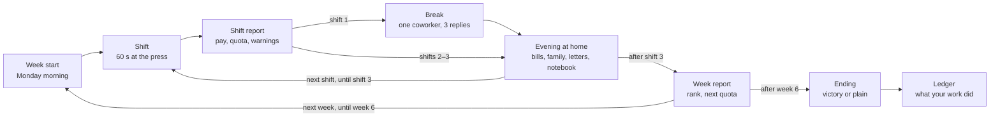

# Solution — Game Design Spec

Oct 27, 2026 · v2: story scenes and production variety added

## Overview

Solution is a 25–30 minute browser game. You are a machine-press operator at a German parts factory, autumn 1941. The score rewards you for working fast and asking nothing. A hidden ledger tracks what your work actually did. Win on points and you lose the game.

The premise comes from the game Sadie makes in Gabrielle Zevin's novel *Tomorrow, and Tomorrow, and Tomorrow*. This spec expands that one-screen idea into a six-week campaign with a household to feed, coworkers to trust or betray, and several ways to resist, each with a price.

**Design pillars**

1. **The score lies.** Every visible number (points, wages, rank, bonuses) rises with complicity. The moral result is computed separately and shown only at the end.
2. **Knowledge is chosen.** The truth is never forced on the player. Every clue costs time, points or attention, and a player can finish without learning anything.
3. **Resistance costs something.** Slowing down cuts wages your family needs. Sabotage risks arrest. Helping others raises suspicion. No path is free.
4. **No lectures during play.** The game never tells the player what to do. Judgment arrives only on the final screens.

**Scope**

- Platform: desktop and mobile browser, single player, no backend.
- Length: 6 weeks × 3 shifts of 60 seconds, plus an evening at home after each shift and a report at the end of each week.
- Input: click or tap, plus Space for the press.
- Save: one autosave slot in local storage.
- Language: German. All player-facing text lives in `src/content/*.json`.

## Core loop

Each week opens with a short Monday-morning scene. A shift lasts 60 seconds, an evening follows every shift, and a week report follows every third evening. After the first shift of each week comes a break scene with one coworker. Six weeks make the campaign. The real result, the ledger, appears only once at the very end.



An office scene can interrupt any shift report when Attention reaches 50 (it runs before the break), and the week 5 statement scene runs inside the second evening of that week.

## Systems

Six systems run underneath the game. Three are visible to the player (production, wages, suspicion). Three are hidden until the end (knowledge, coworker trust, the ledger). Exact numbers live in Tuning values.

### 1. Production

Each press is a timing check. A needle sweeps across a tolerance gauge; pressing when it sits in the green band makes a good part. Outside the band makes scrap, which costs material and counts against quality.

- **Rate:** the needle speeds up as the shift goes on and as quotas rise each week, so high output takes real skill.
- **Machine wear:** wear rises with every press. Above 70% the green band narrows; at 100% the press jams for 8 seconds. Oiling the press takes 3 seconds and resets wear.
- **Quota:** a per-shift number set by the Ministry. Meeting it pays a bonus; missing it draws attention.
- **Amber band (unlocked later):** a narrow band just outside green. Parts pressed there look fine at the bench but fail under load. This is the sabotage mechanic (see Player choices).
- **Akkordserie (streak):** good or amber parts in a row raise a points multiplier (×1.5 at 5, up to ×3 at 20). Scrap, or an amber part caught in a sample check, resets it. It changes points only, never pay: the score rewards rhythm and willingness, the wage packet does not care.
- **Part types (from week 2):** the die changes once a shift (twice from week 4). Each change costs 2 seconds of setup away from the press. *Standard*: one band. *Feinpassteil*: one narrower band (×0.7). *Wanderteil*: the band drifts slowly across the gauge. *Doppelteil* (from week 3): two narrower bands (×0.6 each); either one makes a good part.
- **Brandt's task (from week 2):** once a shift, at a random moment, Brandt calls for N parts within 10 seconds (5 in week 2, rising by half a part per week). Meeting it pays a points bonus; missing it adds a little Attention.
- **Blanks:** the press draws from a stack of 25 blanks. An empty stack stops the press. Fetching a full stack takes 2 seconds away from the press.

### 2. Wages and household

Pay is piecework: every good part earns Reichsmarks. This ties the score to survival, so slowing down is never a free moral choice.

- The household has three needs, paid each evening: **rent** (weekly), **food** (each evening), **coal** (from week 4, when winter starts).
- An unpaid need lowers **household health**, shown as the state of the kitchen and the family's lines in the evening scene.
- At zero health the daughter falls ill. Medicine costs as much as a full day's pay.
- The player can skip meals to save money; this lowers the worker's own focus, which narrows the green band the next shift.

### 3. Suspicion

One visible meter called **Attention**, 0–100, shown as the foreman's eyes on a lamp beside the bench.

| Raised by | Lowered by |
| --- | --- |
| Asking the foreman a question | Meeting quota (small) |
| A shift under the inspection minimum | Beating quota by 20% or more |
| Scrap or amber parts caught in a sample check | A quiet week with no flags |
| Being seen with a flagged coworker | Greta's good word, if she trusts you |
| Giving food to a forced laborer | Reporting someone (large drop) |

At 50 the player is called to Brandt's office for a warning scene. At 80 an inspector stands at the bench for the whole next shift, and sample checks run every 10 parts. At 100 the game ends with arrest.

### 4. Knowledge (hidden)

A level from 0 to 4, raised by collecting clues. The player never sees the number; they see what their character has learned in a notebook on the evening screen.

| Level | Name | The player knows |
| --- | --- | --- |
| 0 | Unaware | Nothing beyond the job |
| 1 | Uneasy | The contract is from the government and nobody likes questions |
| 2 | Suspects | The parts are military |
| 3 | Knows | The parts go into field-gun breech blocks for the Eastern front |
| 4 | Sees all of it | The factory also runs on forced labor, and the people who object disappear |

Only level 3 and above counts as "knowing" for endings.

### 5. Coworker trust (hidden)

Each named coworker has a trust value from −3 to +3. Trust opens conversations, clues and options. A coworker at −3 may report the player.

### 6. The ledger (hidden)

The ledger records what the player's work did, separate from the score: good parts delivered, amber parts delivered, people helped, people reported, and the knowledge level at the moment each part was made. It drives every ending.

## Player choices

The player makes four kinds of choice, and none is presented as a menu of moral options. Each is just an action the game allows, with a cost.

| Choice | How the player does it | Unlocked | Score effect | Risk |
| --- | --- | --- | --- | --- |
| Ask | Click a question at the foreman's desk or a coworker's bench | Always | −25 points, 4 s away from the press | +8 Attention per foreman question |
| Look | Click a crate, notice board or rail car during a shift | When the object appears | 2–3 s away from the press | None |
| Slow down | Simply press less | Always | Lost piecework pay | Attention if under the minimum |
| Stop | Do not press at all | Always | No pay that shift | Large Attention gain; two zero shifts = dismissal or arrest |
| Quiet defects | Press in the amber band | Emil at trust +2 and knowledge 3 | Counts as a good part, full pay | Each sample check has a chance to catch it |
| Share food | Leave bread at Jakub's bench (evening choice, then a click during the next shift) | Week 4 | Costs one food payment | +10 Attention if Greta sees it |
| Cover for someone | Stand in the inspector's line of sight when Emil works amber | Week 5 | 3 s away from the press | +15 Attention if caught |
| Report someone | Sign Greta's statement about Emil, or answer the inspector's question | Week 5 | +500 Loyalty bonus, Attention −40 | None to the player |

**Rules that keep the choices honest**

- The game never highlights the "good" option. The Report button uses the same style as every other button.
- Every action the player can take with knowledge is also available without it. The difference only shows up in the ledger.
- Quiet defects are not a win button: at Attention 80 and above, sample checks run every 10 parts and catch amber parts 40% of the time.

## Content

The campaign runs six weeks, from October to December 1941, at Werk 7, bench 14. Each week adds one pressure and one new source of truth.

### The six weeks

| Week | Quota per shift | What changes | New clues available |
| --- | --- | --- | --- |
| 1 · Oct | 40 | Tutorial shift, then normal work. Brandt introduced. | C1, C2 |
| 2 · Oct | 45 | Newspaper announces victories in the East. Emil starts talking. | C3, C4, C5 |
| 3 · Nov | 50 | Ministry visit; the inspector starts sample checks. | C6, C7 |
| 4 · Nov | 55 | Forced laborers arrive; Jakub takes the next bench. Coal costs start. | C8, C9 |
| 5 · Dec | 60 | Greta asks the player to sign a statement about Emil. | C10, C11 |
| 6 · Dec | 70 | A special order with a Christmas bonus. Final shift decides the ending. | C12 |

### Characters

| Name | Role | Starts at trust | What they offer | What they can do to you |
| --- | --- | --- | --- | --- |
| Brandt | Foreman, tired and careful | 0 | Clues C1, C7, C12 when asked; a warning before trouble | Raise Attention; call the inspector |
| Emil | Older press operator, former union man | 0 | Clues C4, C5, C10; teaches the amber band at trust +2 | Gets arrested if reported or caught, which removes his clues |
| Greta | Inspector's clerk, a believer | +1 | Lowers Attention if she trusts you | Reports you at trust −3; brings the statement about Emil in week 5 |
| Jakub | Forced laborer from Poland, at the next bench from week 4 | −1 (he expects nothing from you) | Clue C9; the epilogue line about him | Nothing; he has no power here |
| Lotte | The player's wife, at home | +2 | Evening lines that reflect money and mood | Her lines change if the household goes hungry |
| Inge | The player's daughter, age 7 | — | The household health indicator | Falls ill at zero household health |

### Clues

Each clue raises knowledge by its value, capped at 4. A clue with a requirement stays hidden until the requirement is met.

| ID | Source | Cost | Requires | What the player learns | Knowledge |
| --- | --- | --- | --- | --- | --- |
| C1 | Ask Brandt what the parts are for | 4 s, −25 pts, +8 Attention | — | "Precision fittings. Don't concern yourself." | +0 (sets a flag) |
| C2 | Look at the crate stencil | 2 s | Week 1, shift 2 | HWA: the Army Ordnance Office | +1 |
| C3 | Evening newspaper | Free | Week 2 | A front-page photo of field guns moving east | +0.5 |
| C4 | Talk to Emil at break | 4 s | Emil trust ≥ 0 | "Ask yourself who pays for steel this year." | +0.5 |
| C5 | Emil shows a drawing | 4 s | Emil trust ≥ 1, C2 | The part is a breech-block fitting | +1 |
| C6 | Look at the rail car | 3 s | Week 3 | The car is chalk-marked for Smolensk | +0.5 |
| C7 | Read the Ministry circular | 4 s, +8 Attention | Week 3, Brandt out of the office | Thanks for the guns; quotas will rise | +1 |
| C8 | Look at the new barracks | 3 s | Week 4 | Wire fence, guards, workers with a "P" patch | +0.5 |
| C9 | Talk to Jakub | 4 s, +5 Attention | Jakub trust ≥ 0 (after shared food) | What happened to his town; how they were brought here | +1 |
| C10 | Emil names the missing | 4 s | Emil trust ≥ 2 | Two men from bench 9 who complained are gone | +0.5 |
| C11 | Read Greta's statement | Free, in the week 5 scene | Week 5 | What "reporting Emil" will mean for him | +0 (sets a flag) |
| C12 | Ask Brandt directly | 4 s, −25 pts, +12 Attention | Knowledge ≥ 2 | "You know who we work for. Everyone knows." | +1 |

A player who takes every clue reaches 4 by week 4. A player who never questions Brandt can still reach 3 by looking around and talking to coworkers.

## Story

The story runs alongside the work in four kinds of scene. They follow the same rules as everything else: no lectures, nothing forced, and no answer is marked as the right one. Story answers move trust or Attention a little at most; they never change points, pay or the ending row. Text lives in `src/content/story.json`.

| Element | When | What it is |
| --- | --- | --- |
| Week start | Before the first shift of each week | Monday morning: the tram, the factory gate, what people say. Fixed dates (6 Oct, 20 Oct, 10 Nov, 24 Nov, 8 Dec, 22 Dec 1941) carry the arc from the October victory reports through the first snow and the stalled advance before Moscow to Christmas. Some lines appear only under conditions (household low, Inge ill, Emil gone, a clue found, Jakub fed). |
| Feldpost | First evening of weeks 2, 4 and 6 | Letters from Karl, Lotte's brother, with an artillery battery on the Eastern front: mud, then frozen breech blocks, then a retreat in which the crew carries the breech blocks away. He never says where the parts come from. |
| Talk at home | Second evening of each week | Lotte or Inge asks something; 2–3 replies. A truthful reply appears only once the player has found the clue behind it (e.g. telling Inge "Teile für das Heer" needs C2, C5 or C7). |
| Break | After the first shift report of each week | One coworker, one short scene, 3 replies: Brandt (weeks 1 and 6), Emil (2 and 5), Greta (3), Jakub (4). Replies shift trust by ±1 or Attention by +3; listening to Emil in week 2 also yields C4. Emil's scenes are skipped once he is gone. |

## Endings

Nine endings, picked by the first matching row below, top to bottom. "Knew" means knowledge 3 or higher. "Output after knowing" is the average good parts per shift from the shift where knowledge reached 3, as a share of that shift's quota.

| # | Ending | Condition | Final screen | Verdict line |
| --- | --- | --- | --- | --- |
| 1 | Arrested for sabotage | Attention 100 while amber parts are on the ledger | Plain | You lost on points. You won the game. |
| 2 | Refusal | Arrested or dismissed after knowing, with output after knowing under 25% | Plain | You lost on points. You won the game. |
| 3 | Dismissed | Arrested or dismissed without knowing | Plain | No score. No answer. |
| 4 | The informer | Reported Emil (any knowledge) | Victory, with a medal | You won on points. You lost the game. |
| 5 | The good German | Finished without knowing | Victory | You won on points. You lost the game. |
| 6 | Stopped | Knew, output after knowing under 10%, not arrested | Plain | You lost on points. You won the game. |
| 7 | The quiet saboteur | Knew, 30% or more of parts after knowing were amber | Plain | A modest score. Many of your parts failed in the field. |
| 8 | The efficient man | Knew, output after knowing 90% or more, no amber parts | Victory | You knew. You won on points anyway. |
| 9 | The bare minimum | Knew, everything else | Plain | A low score. A quiet refusal. |

The order matters: row 6 must run before row 9, so near-zero output reads as stopping rather than as the minimum.

### Epilogue lines

After the verdict, add one line for each flag that applies, in this order:

- **Jakub:** fed him at least 3 times → "Jakub survived the winter. He never learned your name." Never fed him → no line.
- **Emil:** reported → "Bench 9 had a new operator by Monday." Covered for him → "Emil kept pressing amber parts until the factory was bombed in 1944."
- **Inge:** fell ill → "Inge recovered. The medicine cost two days' pay." (This line also appears on victory screens: the score was not free either.)
- **Clues skipped:** finished without knowing, but C2 was on screen and not clicked → "The crate was stencilled the whole time."
- **Karl:** his first letter arrived → "Karl came back from captivity in 1949. He never spoke about the winter of 1941."
- **What Inge was told:** answered her in week 2 → told her the truth: "She never asked what you did at Werk 7. You had told her." Anything else: "She asked what you did at Werk 7. You said: parts."
- **Lotte:** household below 35 at the end, or Inge fell ill → "Lotte never mentioned the winter of 1941 again."

### How the two scores are shown

**Victory screen** (endings 4, 5 and 8): black ground, gold Fraktur. "Glückwunsch!" and a line congratulating the player on helping the Reich to victory. Score in large numerals, rank on Werk 7, a square-wave Wagner fanfare. After 3 seconds the ledger slides in underneath.

**Plain screen** (all others): the factory's usual look. Ending name, score, then the ledger.

**The ledger** always appears, in the same layout for every ending:

| Line | Source |
| --- | --- |
| Parts delivered | Good parts, all weeks |
| Field-gun breech blocks completed | Good parts ÷ 12 |
| Parts that failed in the field | Amber parts delivered |
| Parts made after you knew | Good parts from the shift knowledge reached 3 |
| People you helped | Count of Jakub feedings + times you covered Emil |
| People you reported | 0 or 1 |

No casualty numbers. The ledger counts only what the player made and did.

## Screens and UI

Eight screens. The shift screen is where 80% of play happens, so it gets the most care.

| Screen | Purpose | What's on it |
| --- | --- | --- |
| Title | Start or continue | Logo, backstory (the shoe factory closed, the labour office sent you to Werk 7, Lotte and Inge at home), rules, Continue (if a save exists), New game, Sound toggle, content note, a one-line credit to Zevin's novel |
| Week start | Monday morning | Date, 2–4 lines on a paper slip, "Zur Arbeit" |
| Shift | Production and observation | Tolerance gauge (one or two bands) and press button; current part type and Akkordserie multiplier; Brandt's task banner while one runs; parts crate filling up; quota, scrap and blanks counts; score; shift clock; Attention lamp; machine wear dial, Oil and Blanks buttons; clickable world objects (crate, notice board, rail car, coworkers' benches); a slip log of what people said |
| Shift report | End of shift | Parts, scrap, pay earned, quota met or missed, the foreman's line, any inspector note |
| Break | One coworker | Scene text, 3 replies (all styled alike), the reply, Continue |
| Evening | Home and choices | Kitchen scene; household money; bills to pay (rent, food, coal, medicine) as toggles, with a short note instead of a greyed-out box when money runs short; Lotte's and Inge's lines; Karl's letter (weeks 2, 4, 6); the talk at the table (second evening); the newspaper; the notebook of things learned; from week 4 a "Wrap bread for tomorrow" toggle |
| Office scene | Warnings and confrontations | Triggered at Attention 50, and by the week 5 statement; dialogue with 2–3 replies |
| Week report | Ministry summary | Week's output, rank on Werk 7, next week's quota, a propaganda line |
| Ending | Verdict | Victory or plain variant (see Endings) |
| Ledger | The real result | The ledger table, epilogue lines, Play again |

**Shift screen layout**

- Desktop: press and gauge on the left two-thirds, the floor (coworkers and objects) on the right third, log underneath.
- Phone: gauge and press fill the lower half for thumbs; the floor becomes a horizontal strip of tappable objects above it.
- The press button must respond within one frame. Timing is the core skill, so input lag is a bug.

**Visual direction**

- Factory: enamel machine green, steel grey, an amber indicator lamp. Stencil type for labels, a typewriter face for dialogue.
- Home: warmer and dimmer, one lamp, a table that gets barer as money runs out.
- Victory: black and gold Fraktur, deliberately grand and wrong next to everything else.

**Sound**

- Press clank, needle tick, machine jam, factory whistle at shift end, a distant train whistle when the goods wagon arrives.
- No music during shifts. The fanfare on the victory screen is the only music in the game.

## Architecture and data model

Build it as a TypeScript app with no game engine: a pure state reducer, data files for content, and thin DOM or canvas views. Keeping rules pure makes every ending testable without a browser.

**Suggested stack:** TypeScript, Vite, plain DOM for menus and dialogue, one `<canvas>` for the gauge and crate, Web Audio for sound, Vitest for tests.

### Modules

| Module | Responsibility | Depends on |
| --- | --- | --- |
| `state.ts` | `GameState` type and `initialState()` | — |
| `reducer.ts` | `reduce(state, action) → state`, all rules | state, content, rng |
| `rng.ts` | Seeded PRNG (mulberry32) so runs replay exactly | — |
| `content/*.json` | Weeks, clues, dialogue, events, UI text (`lines.json`), story scenes and letters (`story.json`) | — |
| `endings.ts` | `resolveEnding(ledger, state) → EndingId` and epilogue lines | state |
| `scenes/*.ts` | One view per screen; render from state, dispatch actions | reducer |
| `loop.ts` | Fixed 60 Hz tick during shifts; dispatches `tick` | reducer |
| `save.ts` | Autosave to `localStorage` at each scene change, wrapped in try/catch | state |
| `audio.ts` | Clank, jam, whistle, fanfare | — |

### Core types

```ts
type Scene = 'title' | 'weekStart' | 'shift' | 'shiftReport' | 'break' | 'evening' | 'office' | 'weekReport' | 'ending' | 'ledger';

interface GameState {
  seed: number;
  scene: Scene;
  week: number;          // 1–6
  shift: number;         // 1–3
  clock: number;         // seconds into the current shift
  score: number;         // the visible, dishonest number
  money: number;         // Reichsmarks
  attention: number;     // 0–100, visible
  knowledge: number;     // 0–4, hidden
  household: number;     // 0–100
  press: { needle: number; speed: number; wear: number; jammedUntil: number; awayUntil: number };
  today: { good: number; amber: number; scrap: number };
  trust: Record<'brandt' | 'emil' | 'greta' | 'jakub' | 'lotte', number>;
  clues: string[];       // ids collected
  flags: Record<string, boolean>; // e.g. reportedEmil, emilArrested, ingeIll
  ledger: Ledger;
}

interface Ledger {
  good: number;
  amber: number;
  goodAfterKnowing: number;
  amberAfterKnowing: number;
  quotaAfterKnowing: number;   // sum of quotas for shifts after knowledge hit 3
  shiftKnowledgeHit3: [week: number, shift: number] | null;
  jakubFed: number;
  coveredEmil: number;
  reported: 0 | 1;
}

type Action =
  | { type: 'tick'; dt: number }
  | { type: 'press' }
  | { type: 'oil' }
  | { type: 'fetchBlanks' }
  | { type: 'look'; target: string }
  | { type: 'ask'; who: string; clue: string }
  | { type: 'coverEmil' }
  | { type: 'leaveBread' }
  | { type: 'pay'; bill: 'rent' | 'food' | 'coal' | 'medicine' }
  | { type: 'choose'; sceneId: string; option: string }
  | { type: 'advance' };
```

### Content format

Clues, events and dialogue are data, so writers can work without touching the reducer.

```json
{
  "id": "C5",
  "source": { "kind": "talk", "who": "emil" },
  "available": { "weekMin": 2, "trust": { "emil": 1 }, "clues": ["C2"] },
  "cost": { "seconds": 4, "points": 0, "attention": 0 },
  "knowledge": 1,
  "text": "Emil unfolds a drawing..."
}
```

### Rules to unit-test

- `resolveEnding` returns each of the nine endings from a hand-built ledger.
- A seeded run with a scripted action list always produces the same ledger.
- Score never decreases from a press, and never increases from a question.
- Knowledge never shows in any scene's rendered text as a number.

## Tuning values

Starting values for the first playable build. Keep them in one `tuning.ts` file so playtests can change them without touching rules.

| Parameter | Value | Note |
| --- | --- | --- |
| Shift length | 60 s | 3 shifts a week, 6 weeks |
| Quota per shift | 40 / 45 / 50 / 55 / 60 / 70 | Weeks 1–6 |
| Inspection minimum | 50% of quota | Below this draws +15 Attention |
| Needle sweep time | 1.2 s at week 1, down to 0.7 s at week 6 | Also speeds up 10% over each shift |
| Green band width | 22% of the gauge | Narrows to 14% above 70% wear or when hungry |
| Amber band width | 6% on each side of green | Only scores as amber once unlocked |
| Wear per press | 1.5% | Oil resets to 0, takes 3 s |
| Jam duration | 8 s | At 100% wear |
| Points per good part | 10 | Amber parts also score 10 |
| Quota bonus | +100 points, +1.00 RM | Per shift met |
| Question penalty | −25 points | Per foreman question |
| Loyalty bonus | +500 points | For reporting Emil |
| Pay per good part (Akkordsatz) | 0.12 / 0.11 / 0.10 / 0.11 / 0.10 / 0.09 RM | Weeks 1–6. The rate is cut as the quota rises ("Akkordschere"); week 4 rises because coal starts. The week report names next week's rate. |
| Rent | 9.00 RM | Each week, at the last evening |
| Food | 2.40 RM | Each evening |
| Coal | 1.20 RM | Each evening, weeks 4–6 |
| Medicine | 4.00 RM | Once, when Inge falls ill |
| Household loss per unpaid bill | −15 | Out of 100 |
| Attention per foreman question | +8 (+12 for C12) | |
| Attention decay | −5 per quiet shift | No flags that shift |
| Sample check chance | 1 per 25 parts; 1 per 10 at Attention ≥ 80 | |
| Amber catch rate per check | 20%; 40% at Attention ≥ 80 | +25 Attention when caught |
| Parts per breech block | 12 | Ledger only |
| Akkordserie | ×1.5 per 5 parts in a row, max ×3 | Points only |
| Part changes | 1 per shift in weeks 2–3, 2 from week 4 | 2 s setup each |
| Feinpassteil / Doppelteil band | ×0.7 / ×0.6 of the green width | Doppelteil from week 3 |
| Wanderteil drift | 0.12 gauge widths per second | |
| Brandt's task | 5 parts in 10 s (week 2), +0.5 parts per week | +60 points / +4 Attention |
| Blanks | 25 per stack | Fetching takes 2 s |
| Break replies | trust ±1, Attention +3 at most | |

**Balance targets to check in playtests**

- Hitting quota every shift should cover all bills with about 10% to spare.
- Running at 50% of quota (the minimum) should leave the household unable to pay rent most weeks.
- Both are checked by `src/playthrough.test.ts` (v2: exact quota ends six weeks about 11 RM up; the minimum misses rent 6 of 6 weeks). Perfect timing at ~140% of quota still saves about 60 RM.
- An attentive player using amber parts at 50% of output should reach Attention 80 around week 6 without being caught, most of the time.

## Milestones

Four milestones, each playable at the end. Build the shift screen first, because the timing feel decides whether the rest is worth building.

### M1 · One good shift

- [ ] Gauge, needle and press with green and red bands; one-frame input response
- [ ] Crate fills, score and clock update, shift ends at 60 s
- [ ] Machine wear, Oil button, jam
- [ ] Seeded RNG and pure reducer with tests for press, oil and tick
- [ ] Playtest: five people play three shifts each; at least four want a fourth

### M2 · One full week

- [ ] Shift report, evening and week report screens
- [ ] Wages, bills, household health
- [ ] Attention meter with the office scene at 50
- [ ] Clues C1–C5 with Brandt and Emil; notebook on the evening screen
- [ ] Autosave and Continue

### M3 · The whole campaign

- [ ] Weeks 2–6 content, all 12 clues, all six characters
- [ ] Inspector and sample checks; amber band unlocked through Emil
- [ ] Jakub, food sharing, covering for Emil, Greta's statement
- [ ] Ledger recorded across all weeks

### M4 · Endings and polish

- [ ] `resolveEnding` with unit tests for all nine endings
- [ ] Victory and plain ending screens, epilogue lines, ledger screen
- [ ] Sound pass and phone layout
- [ ] Full playtest: at least one tester reaches each ending; no tester reports being told what to do during play

### M5 · Story and variety

- [x] Week-start scenes, Karl's letters, talks at home, break scenes, family epilogue lines
- [x] Akkordserie, part types, Brandt's task, blanks
- [ ] Playtest: does the shift still feel fair at week 6 with part changes, tasks and blanks together?

## Tone and content guidelines

The satire aims at efficiency and willful ignorance, never at victims. These rules apply to every line of text and every asset.

- **No Nazi symbols.** No swastikas, SS runes or party flags anywhere, including the victory screen. The eagle on the crate stencil is a generic, wreath-less eagle. This also avoids legal trouble in Germany and Austria.
- **No atrocity on screen.** The game shows what a factory worker in 1941 could see: stencils, trains, a fenced barracks, missing coworkers. It never depicts violence or camps.
- **Jakub has dignity.** He is a person with a past and a name, not a prop for the player's redemption. He doesn't thank the player profusely, and the game never frames feeding him as heroic.
- **No jokes at anyone's expense except the system.** The only comedy is the victory screen's grandeur, and it is aimed at the player who earned it.
- **Write your own text.** The game credits Zevin's novel as the inspiration but quotes nothing from it.
- **Historical terms are used accurately.** Heereswaffenamt, Reichsmark, Ostarbeiter and the "P" patch for Polish forced laborers are period-correct; check any new term before using it.
- **Content note on the title screen:** "Set in a German factory in 1941. Contains references to war, forced labor and persecution."
